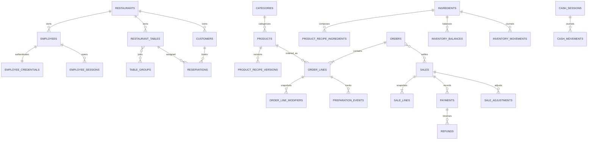

# Base PostgreSQL: esquema y migraciones

Esta fase solo crea la estructura PostgreSQL y su runner. La aplicación y sus APIs siguen leyendo y escribiendo SQLite; no hay importador de datos ni conexión PostgreSQL desde el runtime.

## Relaciones principales



Todas las entidades de restaurante llevan `restaurant_id`; sus claves foráneas usan `(restaurant_id, id)` para rechazar referencias entre tenants. Esto no implementa por sí solo aislamiento de lectura: los repositorios futuros deberán filtrar cada consulta por tenant y aplicar autorización/RLS antes de exponer datos.

`db/postgres/migrations/0001_restaurant_core.sql` incluye:

- Identidad: `employees`, `employee_credentials`, `employee_sessions`, `login_attempts` y `security_events`. Credenciales y sesiones quedan en tablas separadas de las proyecciones normales. Los estados Phase 2B son `active`, `must_change` y `reset_required`; el último no puede tener hash y los dos primeros exigen `scrypt-v1` con salt de 16 bytes y hash de 32 bytes.
- Operación: `restaurant_tables`, membresías de `table_groups`, `customers`, `reservations`, `orders`, líneas, modificadores, eventos de estado y eventos de preparación por línea/cantidad.
- Catálogo e inventario: categorías de producto, modificador e ingrediente; productos, modificadores, versiones de receta, balances para actualización concurrente y movimientos con unidad explícita.
- Finanzas: `cash_sessions`, movimientos, ventas, enlaces a pedidos, líneas y documentos con snapshots, intentos/pagos, reembolsos y ajustes. No se agregaron campos de impuestos, adquirentes, ni proveedores de pago que V9 no usa.
- Concurrencia y recuperación futura: `idempotency_records`, `entity_revisions`, `audit_events` y `outbox_events`.

La versión de receta y los campos de snapshot conservan el nombre/precio/modificadores aceptados aunque el catálogo cambie después. El servicio futuro debe insertar venta, líneas, pagos, movimientos de caja/inventario, auditoría y outbox en una sola transacción idempotente. El esquema no puede validar sumas de pagos/líneas contra una fila padre con `CHECK`; esas invariantes requieren transacción y validación en servidor.

## IDs, cantidades, moneda y tiempo

- Los IDs son `text`, incluidos IDs legados numéricos convertidos a su representación decimal y los IDs prefijados. Un importador debe detectar una posible colisión entre un ID JSON numérico `1` y un ID textual `"1"` dentro de la misma entidad; si aparece, debe detenerse y pedir una asignación explícita, nunca sobrescribir.
- Precios, totales, propinas, costos y cantidades usan `NUMERIC` sin escala forzada. V9 admite COP y USD, pero sus valores viven como `Number` de JavaScript y también hay costos fraccionarios por unidad. No se inspeccionó la base activa ni se probó cada valor; por eso esta fase no convierte a unidades menores ni establece una regla de redondeo. El importador/API futura debe recibir y devolver decimales como cadenas y definir redondeo por moneda con fixtures del negocio antes del corte.
- Los instantes se guardan como `TIMESTAMPTZ`. En V9 los campos históricos pueden venir como milisegundos numéricos o texto; la normalización y zona horaria deben verificarse por campo en una fase de importación. Las reservas representan fecha y hora local de operación y necesitarán zona horaria explícita del restaurante antes de convertirse a instante.
- Las cantidades usan `NUMERIC` y conservan unidades verificadas en V9: `g`, `kg`, `ml`, `L`, `unidad`. La validación de conversión entre familias se mantiene como regla de dominio, no como `CHECK` entre filas.

## Índices y reglas importantes

- La cola activa usa `orders_active_queue_idx`; el historial consulta por mesa/cliente y fecha mediante `orders_table_history_idx` y `orders_customer_history_idx`.
- `reservations_schedule_idx` sirve agenda por fecha/estado; productos tienen índice de categoría/activo; clientes por nombre/telefono.
- Los ledgers indexan ventas por fecha y movimientos por ingrediente, sesión, venta u orden; auditoría se indexa por entidad/fecha. `employee_sessions_active_expiry_idx` sirve revocación/expiración.
- `cash_sessions_one_open_idx` permite una sola caja abierta por restaurante, como el estado singleton actual de V9. Una futura operación con varias cajas físicas necesitará cambiar esta regla y su alcance.
- `UNIQUE (restaurant_id, order_number)`, claves compuestas y referencias `ON DELETE RESTRICT` protegen identidad e historia. Los grupos pueden tener cero o un miembro temporalmente; el mínimo de dos mesas se valida en la operación que fusiona/desfusiona, porque no es una restricción de fila. No se impone unicidad por nombre de mesa: hay un defecto de duplicación de mesas ya identificado y el esquema no debe impedir una futura reconciliación que preserve IDs.
- V9 permite nombres de producto repetidos como variantes; no se añade un índice único de producto. El UI sí evita categorías duplicadas sin distinguir mayúsculas/minúsculas; la base limita nombres exactamente iguales y el servidor/importador deberá alinear la normalización y la collation antes del corte.
- Pagos, ventas, reembolsos, ajustes, auditoría y movimientos son ledgers conceptualmente append-only. El rol de runtime aún no existe; su creación posterior debe negar `DELETE` y actualizaciones de historia, y reservar DDL al dueño de migraciones.

## Runner

El runner requiere `POSTGRES_MIGRATION_DATABASE_URL` explícita. No consulta `DATABASE_URL`, `DB_PATH` ni SQLite. Consume la URI sin imprimirla ni pasarla como argumento de proceso; extrae host/puerto/base/usuario y deja la contraseña solo en el entorno del proceso `psql`. Se puede omitir la contraseña de la URI y usar el archivo `.pgpass` del usuario o `PGPASSFILE` con ACL privada.

PowerShell, apuntando únicamente a una base PostgreSQL desechable de desarrollo/pruebas:

```powershell
$env:POSTGRES_MIGRATION_DATABASE_URL = 'postgresql://pos_migrator@127.0.0.1:5432/restaurant_schema_test?sslmode=disable'
npm run db:pg:migrate
Remove-Item Env:POSTGRES_MIGRATION_DATABASE_URL
```

No incluir una contraseña literal en comandos guardados en el historial de PowerShell. El runner usa un advisory lock y una única transacción, crea `public.schema_migrations`, registra SHA-256 y se niega a continuar si encuentra una versión desconocida, un hueco en el historial o un nombre/checksum distinto. Solo acepta migraciones SQL consecutivas `0001_...sql`; no deben contener comandos `psql`, `BEGIN/COMMIT` propios ni operaciones incompatibles con transacción como `CREATE INDEX CONCURRENTLY`. Una migración fallida revierte la transacción completa. Repetirlo verifica checksums y no duplica objetos.

El destino debe ser una base aislada creada previamente por el operador; `psql` y sus permisos de conexión deben estar disponibles. La configuración actual no incluye PostgreSQL ni Docker y no se pudo ejecutar la migración en esta máquina.

### Pruebas de integración PostgreSQL

`npm run test:pg-migration-integration` exige `POSTGRES_INTEGRATION_TEST_URL`, un host loopback y un nombre de base que identifique explícitamente un destino de prueba. Desde esa base administrativa crea bases temporales con prefijo `pos_p2a_test_`, ejecuta el runner y el SQL real, y elimina solo esos nombres generados al terminar. Usa únicamente una instancia PostgreSQL desechable con permiso `CREATEDB`/`DROP`; no apuntes a producción ni al servidor operativo. El workflow `.github/workflows/postgres-migration-integration.yml` proporciona PostgreSQL 18.6 con credenciales efímeras de prueba y destruye la instancia al finalizar el job.

## Despliegue futuro

PostgreSQL debe permanecer en una red privada y no aceptar conexiones desde navegadores ni la red pública. Usar TLS para conexiones remotas, firewall/lista de hosts, un rol propietario separado que ejecute migraciones y un rol de runtime con permisos mínimos. El rol de runtime no debe poder cambiar el esquema ni borrar registros históricos; credenciales, sesiones y eventos de seguridad no deben formar parte de respuestas de estado ordinarias. Antes de operar con varios restaurantes, implementar y probar aislamiento de tenant en cada operación (preferiblemente RLS además de filtros explícitos), límites de retención para eventos de login/sesiones/outbox y restauración desde backups.

## Lo que se difiere

- No hay pruebas de integración PostgreSQL ejecutadas ni afirmación de que el DDL fue aceptado por un servidor: no hay `psql`, servidor, Docker/Podman ni driver PostgreSQL instalado en el entorno inspeccionado.
- Esta fase no crea roles de despliegue, políticas RLS, triggers de inmutabilidad, procedimientos de negocio, reservas de inventario ni reglas de múltiples cajas.
- Hace falta decidir zona horaria del restaurante, precisión/redondeo monetario, collation para nombres de categoría, tratamiento de mesas duplicadas sin perder sus IDs, reservas solapadas, reglas de reembolso parcial, retención de eventos y asignación de legacy IDs mixtos antes de importar.
- El runner implementa migraciones transaccionales sobre un destino PostgreSQL configurado explícitamente; no valida que el destino sea desechable ni ejecuta importación alguna. El operador debe verificar nombre/entorno de la base antes de ejecutarlo.
